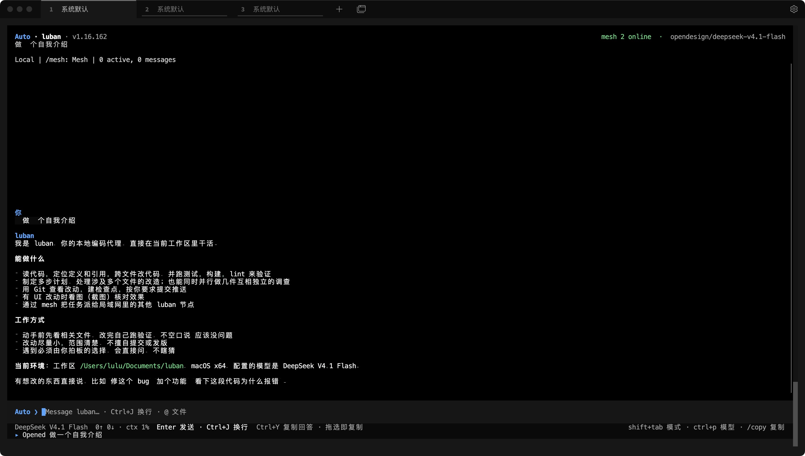

# luban

<p align="center">
  
</p>

<p align="center">
  AI 分布式通用助手 · 终端 / 桌面 / 浏览器 / 手机，同一份项目、同一套会话
</p>

luban 在你的项目里读代码、改文件、跑命令、验证结果，把一个想法做到能运行、能验证；也能把任务交给局域网里的其他电脑执行。

**v2.0.0** 汇集桌面工作台、常驻 Bot、桌宠「造物主」以及进程、Agent 与任务 token 状态展示。升级说明与当前边界见 [版本记录](CHANGELOG.md)。



## 亮点

- **过程可见**：执行计划、命令输出，以及每处改动的文件路径、行号与前后对比。
- **四端一套会话**：终端 TUI、桌面 App、浏览器工作台、手机远控，进度与审批同步。
- **跨机协作**：自动发现局域网节点，同步项目文件，把任务交给别的电脑跑。
- **模型自由**：云端与本地模型、OpenAI 兼容、Anthropic、Responses，也能复用 Codex 账号。
- **按需扩展**：技能、MCP 与编辑器插件。
- **不藏权限**：命令与文件操作都在你的机器上、以当前用户权限执行，不是沙箱。

## 安装

| 平台 | 安装包 | 启动 |
| --- | --- | --- |
| macOS x64 / arm64 | `luban-cli-<版本>-mac-<arch>.zip`<br>`luban-desktop-<版本>-mac-<arch>.zip` | `./luban`<br>打开 `luban Desktop.app` |
| Windows x64 | `luban-cli-<版本>-win-x64.zip`<br>`luban-desktop-<版本>-win-x64.zip` | `luban.cmd`<br>`luban-desktop.cmd` |
| Linux x64 / arm64 | `luban-cli_<版本>_<arch>.deb`<br>`luban-desktop_<版本>_<arch>.deb` | `luban`<br>`luban-desktop` |

安装包自带 Node.js，解压或安装后即可运行。macOS 首次打开若被 Gatekeeper 拦截，执行 `xattr -dr com.apple.quarantine .`。

从源码安装（Node.js 20 或更高版本）：

```bash
npm install && npm run build && npm link
```

## 快速开始

```bash
luban                                       # 在当前项目启动
luban /path/to/project                      # 指定项目
luban . --yes --prompt "运行测试并修复失败"   # 一句话跑一次任务
luban web . --port 8642                     # 浏览器工作台
```

启动后直接说目标，例如「解释这个项目的入口」。执行中可以继续补充要求，也可以用 `/queue <任务>` 排队。

常用命令：`/models` 选模型 · `/sessions` 恢复会话 · `/diff` 看改动 · `/export` 导出记录 · `/theme` 换配色 · `/skin` 换皮肤 · `/report weekly` 生成周报 · `/help` 查看全部。

## 常驻 Bot

Bot 是桌宠的灵魂，在后台身体里自称「造物主」：**桌面 App 启动时自动拉起 worker**，状态灯显示未启动 / 待命 / 干活中 / 出错 / 锁残留，点开可看机器负载与内存、活跃 Agent、进程信息、最近任务结果、token 用量和待授权申请；退出 App 时请求停止自己启动的 worker（外部 worker 不会被抢占或停止）。

也可以完全脱离桌面使用：`luban bot run` 启动本机后台任务队列，另开终端用 `luban bot add "检查项目并总结风险" -w /path/to/project` 下任务。支持 `--at` 定时、`--every` 周期执行、`list` 查看结果、`cancel` 取消任务。需审批操作由独立权限文件授权，未授权则记录申请；用 `luban bot permissions` 初始化，`luban bot requests` 查看申请。

macOS 登录后自动启动与权限边界见 [Bot 使用指南](bot.md)。

## 桌面工作台

运行 `npm run desktop -- /path/to/project`，或直接打开安装包里的 luban Desktop；菜单「文件 → 打开项目文件夹」切换工作区。

- **桌宠**：启动桌面 App 自动出现，同时拉起 bot worker；头顶「造物主」状态灯可展开任务与运行状态面板，bot 任务完成后气泡播报结果。点机器人打开主界面；拖入文本/代码文件并确认“喂给 luban”，处理时动画、完成后气泡返回结果。关闭主窗口会隐藏并保留桌宠，文件菜单可退出。
- **编辑器**：文件树 + 多标签编辑、语法着色、`⌘P` 快速打开、`⌘S` 保存，保存前校验磁盘版本并拦截冲突。
- **中间区域**：「代码 / 当前修改」共用同一个位置，新编辑自动展示对比；编辑器不卸载，未保存内容不会丢。
- **控制台**：一次性命令实时输出，可停止、可回看，可切 Markdown 或原始文本。
- **终端**：真 PTY（xterm.js），提示符、颜色、`cd`、`ssh`、`vim` 都按普通终端工作。
- **会话**：多轮合并成一条时间线，执行中可直接追加指令并自动排队；思考过程默认折叠；标题由模型按任务主题命名。
- **主题与模型**：复用 CLI 的配色与模型列表，支持推理强度档位并记忆选择。

细节与已知限制见 [桌面工作台参考](docs/reference.md#桌面工作台)。

## 配置模型

- 内置 provider：codex、opendesign、opencode-go / zen、deepseek、dashscope，以及本地 Qwen / Strata。
- Open Design 设 `OPEN_DESIGN_API_KEY`；OpenCode 设 `OPENCODE_API_KEY` 或 `OPENCODE_ZEN_API_KEY`。
- 自定义 OpenAI 兼容接口：在 `~/.luban/config.json` 里配置 `base_url`、`api_key_env` 与 `models`，示例见 [config.example.json](config.example.json)。
- Codex 账号：装好官方 Codex CLI 后运行 `luban login codex`，再选 `codex/default`。

协议切换、额度与重连等细节见 [详细参考](docs/reference.md#配置)。

## 更多

局域网协作、手机远控、皮肤与加载宠物、日报周报、MCP 与编辑器接入、安全边界、开发验证，见 [详细参考](docs/reference.md)。
