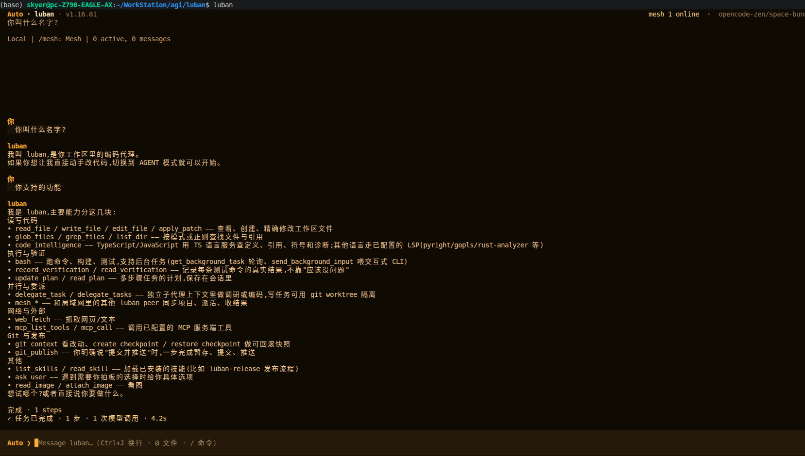

# luban

<p align="center">
  
</p>

luban 是一个 AI 编程助手，帮助你阅读代码、修改文件、运行命令和完成开发任务。支持终端、桌面和浏览器，也可以与局域网中的其他节点协作。

## 界面预览



在终端中直接对话、下发开发任务，并查看任务进度和执行结果。

## 特色功能

- **看得见的执行过程**：任务计划、命令结果和文件修改直接显示在工作台中，每次编辑都能查看行号和前后对比。
- **多台电脑协作**：自动发现局域网节点，把任务交给其他电脑执行，并同步项目文件；远程任务也能查看执行过程。
- **手机远控**：通过手机浏览器或 Android 客户端下发任务、查看进度、确认操作和取消任务，支持局域网直连及公网中继。
- **随时补充，接着完成**：执行中可追加要求或排队新任务；会话可保存、恢复，并导出包含修改记录的文档。
- **自由选择模型**：支持云端与本地模型，也可复用 Codex CLI 的账号登录；在工作台中切换模型和推理强度。
- **按需扩展**：通过技能和 MCP 接入专用工具，也可通过编辑器集成在开发环境中使用。

## 工作日报、周报、月报与年报

在 TUI 输入 `/report daily`、`/report weekly`、`/report monthly` 或 `/report yearly`。可指定日期和输出文件，例如 `/report weekly 2026-10-20 reports/week.md`。默认汇总本机所有项目的 luban、Codex、Claude Code、OpenCode 会话，不限当前 session。

CLI 示例：

```bash
luban report daily
luban report weekly --date 2026-10-20 -o reports/week.md
luban report monthly --sources luban,codex --format json -o reports/month.json
luban report yearly --date 2026-01-01
```

按本机时区划分自然日、周一至周日、自然月和自然年；日期用于选中所在周期。Markdown 按项目展示任务与进展摘要，每个会话每类最多 8 条、每条最多 360 字；JSON 保留时段内收集的用户与助手文本。报告记录来源、会话 ID、原始文件位置和读取异常。所有处理在本机完成，不调用模型。已存在的目标文件不会被覆盖，请使用新文件名。

默认读取 `$LUBAN_HOME/sessions-node`（未设置时为 `~/.luban/sessions-node`）、`$CODEX_HOME`（默认 `~/.codex`）下的 sessions/archived_sessions、`$CLAUDE_CONFIG_DIR/projects`（默认 `~/.claude/projects`）、`$XDG_DATA_HOME/opencode`（默认 `~/.local/share/opencode`）中的旧 JSON 与 SQLite。CLI 支持 `--codex-home`、`--claude-home`、`--opencode-home` 指定其他数据目录。OpenCode SQLite 需要支持 `node:sqlite` 的 Node 22.5+；不可读或缺失来源会在报告中说明。

旧 luban 会话没有逐条消息时间时，按最后更新时间归档并明确标注可能包含此前工作；外部会话按消息时间过滤。报告中的进展属于会话自述。未保存、已删除或保存在其他目录的会话无法自动恢复。

## 安装

Linux 用户可选择对应架构的 `.deb` 安装包：终端版 `luban-cli` 或桌面版 `luban-desktop`。Windows 用户解压对应的便携包后，运行 `luban.cmd` 或 `luban-desktop.cmd`。

从源码安装需要 Node.js 20 或更高版本：

```bash
npm install
npm run build
npm link
```

## 配置模型

配置文件放在 `~/.luban/config.json`，项目配置放在 `.luban/config.json`。可参考 [配置示例](config.example.json)。支持 OpenAI 兼容接口、Anthropic 和 Responses API。

以下配置示例按需选择；已有配置只需合并对应的 `model` 和 `providers` 字段。

### OpenCode Go / Zen

先登录 OpenCode 控制台，开通 Go 或启用 Zen 并复制 API key。[Go](https://opencode.ai/docs/go/) 是订阅服务，[Zen](https://opencode.ai/docs/zen/) 按量计费。

luban 已内置这两个服务，设置对应密钥即可使用（下面命令适用于 Bash / Zsh）：

```bash
# Go（含免费模型）
export OPENCODE_API_KEY="你的 Go API key"
luban --model opencode-go/cat-jam-free

# Zen（含免费模型，支持读取 OpenCode 已保存的 API key 或 Console 登录）
opencode auth login          # 可选：已有 OpenCode 凭据时 luban 会自动读取
export OPENCODE_ZEN_API_KEY="你的 Zen API key"
luban --model opencode-zen/gpt-6-luna
```

也可以启动后用 `/models` 选择。已在 OpenCode 中连接服务时，luban 会读取本机保存的对应凭据。同一个 OpenCode key 现在可以同时用于 Go 和 Zen：在 `providers.opencode-go` 或 `providers.opencode-zen` 任一配置块里写一次 `api_key`，另一块会自动复用；环境变量 `OPENCODE_API_KEY` / `OPENCODE_ZEN_API_KEY` 仍分别对应 Go / Zen。模型和额度以官方页面为准。

> **Zen 免费模型始终显示在 `/models` 里。** 可以直接选择 `opencode-zen/ling-3.1-flash-free`、`opencode-zen/space-bunny-free` 等。luban 读取已有 Zen API key 或 Console 登录，并自动处理 Zen 所需的客户端版本、会话标识和编码工具名称；无需为了 `FreeTierError` 重新进行 OAuth 登录。Go 订阅端也提供 `opencode-go/cat-jam-free` 等免费模型。详见[参考文档](docs/reference.md#免费模型zen-或-go)。

如需保存默认模型，在配置文件中设置：

```json
{
  "model": { "active": "opencode-go/kimi-k3" }
}
```

使用 Zen 时把 `active` 换成 `opencode-zen/gpt-6-luna`；其余 Zen 模型可在 `providers.opencode-zen.models` 中添加，配置方式见下方 API 示例。Go 地址为 `https://opencode.ai/zen/go/v1`，Zen 地址为 `https://opencode.ai/zen/v1`，内置服务无需重复填写地址。

### OpenAI API / 兼容接口

将下面内容写入配置文件，把 `你的模型名` 替换为服务商提供的模型 ID：

```json
{
  "model": { "active": "my-api/你的模型名" },
  "providers": {
    "my-api": {
      "api": "openai",
      "base_url": "https://api.openai.com/v1",
      "api_key_env": "OPENAI_API_KEY",
      "models": ["你的模型名"]
    }
  }
}
```

设置密钥后启动：

```bash
export OPENAI_API_KEY="你的 API key"
luban
```

- `base_url` 填 API 基础地址：OpenAI 官方为 `https://api.openai.com/v1`；代理或其他兼容服务填服务商提供的地址；本地服务例如 `http://127.0.0.1:8000/v1`。
- `api: "openai"` 使用 Chat Completions；服务要求 Responses 时改为 `"responses"`。luban 会自动追加 `/chat/completions` 或 `/responses`，基础地址不用加这些后缀。
- `models` 填实际模型 ID，`model.active` 填 `服务名/模型ID`。上面的 `my-api` 是自定义服务名，两处保持一致即可。
- `api_key_env` 是密钥环境变量名；也可改用 `"api_key": "你的 API key"` 直接保存到本机配置文件。

OpenAI 密钥获取与接口说明见 [官方快速入门](https://developers.openai.com/api/docs/quickstart)。

### Codex 账号

使用 Codex 账号时，先安装官方 Codex CLI，再运行：

```bash
luban login codex
```

在浏览器完成登录后，将以下内容写入配置文件（已有配置只需更新 `model`）：

```json
{
  "model": {
    "active": "codex/default"
  }
}
```

同一任务中的连续工具步骤会按 Codex 会话 ID 续接，只发送新增消息；历史压缩、规则或工具列表变化后会重建上下文。重启 luban 或开始新一轮任务时，会从 luban 保存的历史建立 Codex 会话。Codex 会话由官方 CLI 保存在本地。

底栏显示真实输入/输出 token 和缓存比例，`/status` 显示缓存及推理 token 明细；缓存是输入的子集，推理是输出的子集，不重复累加。每次成功请求的用量也保存在会话的 `performance.requests` 中。需要支持 `--json`、`exec resume` 和用量事件的官方 Codex CLI；未返回用量时会提示统计不完整。

Codex 使用所选推理档位及配置的请求超时，不再自动缩短到 45 秒，也不由 luban 重试已超时的整次请求。会话标题使用本地派生值，避免额外消耗 Codex 额度。实际额度节省取决于任务、上下文和缓存命中率。

## 开始使用

在项目目录运行 `luban`，或者指定项目路径：

```bash
luban /path/to/project
```

直接输入任务，例如“解释这个项目”或“修复测试失败”。文件修改会显示路径、增删行数和修改前后的内容；任务计划在右侧显示。鼠标滚轮可展开并滚动执行详情。

| 操作 | 用途 |
| --- | --- |
| `/help` | 查看命令和快捷键 |
| `/models` | 选择模型和推理强度 |
| `/sessions` | 查看和恢复会话 |
| `/plan` | 显示或隐藏计划 |
| `/diff` | 查看工作区 Git 变更 |
| `/export` | 将会话和修改记录导出为文档 |
| `Shift+Tab` | 切换工作模式，ASK 用于只读分析 |
| `Ctrl+J` | 输入换行 |
| `Esc` | 取消当前任务 |

执行过程中可以继续输入补充要求，或用 `/queue <任务>` 排队。需要确认权限时，按提示允许或拒绝。

## 浏览器与脚本

启动浏览器工作台：

```bash
luban web /path/to/project --host 127.0.0.1 --port 8642
```

打开 <http://127.0.0.1:8642/>。

从命令行提交一次任务：

```bash
luban . --prompt "解释这个项目的入口"
luban . --yes --prompt "运行测试并修复失败"
```

`--yes` 允许工具执行修改和命令，请在可信项目中使用。

## 更多用法

局域网协作、手机远控、插件、编辑器接入及完整配置见 [详细参考](docs/reference.md)。
