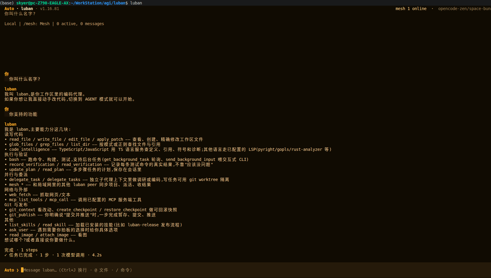

# luban

<p align="center">
  
</p>

luban 是一个 AI 编程助手，帮助你阅读代码、修改文件、运行命令和完成开发任务。支持终端、桌面和浏览器，也可以与局域网中的其他节点协作。

## 界面预览



在终端中直接对话、下发开发任务，并查看任务进度和执行结果。

## 特色功能

- **看得见的执行过程**：任务计划、命令结果和文件修改直接显示在工作台中，每次编辑都能查看行号和前后对比。
- **多台电脑协作**：自动发现局域网节点，把任务交给其他电脑执行，并同步项目文件；远程任务也能查看执行过程。
- **手机远控**：通过手机浏览器或 Android 客户端下发任务、查看进度、确认操作和取消任务，支持局域网直连及公网中继。
- **随时补充，接着完成**：执行中可追加要求或排队新任务；会话可保存、恢复，并导出包含修改记录的文档。
- **自由选择模型**：支持云端与本地模型，也可复用 Codex CLI 的账号登录；在工作台中切换模型和推理强度。
- **按需扩展**：通过技能和 MCP 接入专用工具，也可通过编辑器集成在开发环境中使用。

## 终端皮肤与加载宠物

在 TUI 输入 `/skin`（也可用 `/theme`）打开皮肤选择器，↑/↓ 即时预览，Enter 保存，Esc 还原。`/skin ollobot` 切换为紫色 Ollo 宠物皮肤，`/skin midnight` 恢复默认；Nord、Dracula、樱花粉、浅色等现有配色也可通过同一入口切换。选择会保存到 `~/.luban/node-preferences.json`，下次启动继续使用；也可通过 `luban --theme ollobot` 或配置文件的 `theme` 设置。

Ollobot 复用 lasini 的透明四帧跳跃素材，在本地或 Mesh 任务执行时于进度文字上方播放。终端使用 4 列 × 2 行的细点阵轮廓绘制，避免半格色块并减少占用；这是字符画，无法还原原图五官细节。保留阶段、耗时和停滞提示；窗口小于 80 列或 28 行时只显示原有进度文字。设置 `LUBAN_ANIMATION=0` 可显示静态宠物，屏幕阅读器模式只显示名称。此功能目前用于终端工作台。

## 工作日报、周报、月报与年报

在 TUI 输入 `/report daily`、`/report weekly`、`/report monthly` 或 `/report yearly`。可指定日期和输出文件，例如 `/report weekly 2026-10-20 reports/week.md`。默认汇总本机所有项目的 luban、Codex、Claude Code、OpenCode 会话，不限当前 session。

CLI 示例：

```bash
luban report daily
luban report weekly --date 2026-10-20 -o reports/week.md
luban report monthly --sources luban,codex --format json -o reports/month.json
luban report yearly --date 2026-01-01
```

按本机时区划分自然日、周一至周日、自然月和自然年；日期用于选中所在周期。默认 Markdown 输出适合发给领导的工作日记或阶段汇报，按项目合并重复事项，整理工作内容、实际进展、问题及明确的后续安排，省略无资料的栏目，不附会话编号、工具来源和本地路径。周报、月报和年报按 P0 紧急且重要、P1 重要、P2 常规跟进三档组织，并在末尾列出本期硬节点（含日期与交付物，素材无明确日期时不编造）。长材料分批提炼后合并。正文通过当前配置的模型服务生成，会将所选时段的用户与助手文本发送给该服务；生成失败时不写入文件。Zen 免费模型要求请求携带编码工具，luban 会附带一个不会被调用的占位工具，因此免费模型同样可以生成工作日记。JSON 保留本机收集的原始素材、来源和读取说明，不调用模型。已存在的目标文件不会被覆盖，请使用新文件名。

默认读取 `$LUBAN_HOME/sessions-node`（未设置时为 `~/.luban/sessions-node`）、`$CODEX_HOME`（默认 `~/.codex`）下的 sessions/archived_sessions、`$CLAUDE_CONFIG_DIR/projects`（默认 `~/.claude/projects`）、`$XDG_DATA_HOME/opencode`（默认 `~/.local/share/opencode`）中的旧 JSON 与 SQLite。CLI 支持 `--codex-home`、`--claude-home`、`--opencode-home` 指定其他数据目录。OpenCode SQLite 需要支持 `node:sqlite` 的 Node 22.5+；不可读或缺失来源会在 CLI 或 TUI 提示，并保留于 JSON 素材中。

旧 luban 会话没有逐条消息时间时，按最后更新时间归档，生成时将其标为时间归属待核实，避免直接写成当期已完成成果；外部会话按消息时间过滤。模型根据会话素材整理，发送前请核对实际完成情况。未保存、已删除或保存在其他目录的会话无法自动恢复。

## 安装

Linux 用户可选择对应架构的 `.deb` 安装包：终端版 `luban-cli` 或桌面版 `luban-desktop`。Windows 用户解压对应的便携包后，运行 `luban.cmd` 或 `luban-desktop.cmd`。macOS 用户解压 `luban-cli-*-mac-{x64,arm64}.zip` 后运行 `./luban`，或解压 `luban-desktop-*-mac-*.zip` 后打开 `luban Desktop.app`；两者都已内置 Node.js 运行时，首次打开若被 Gatekeeper 拦截，执行 `xattr -dr com.apple.quarantine .`。

从源码安装需要 Node.js 20 或更高版本：

```bash
npm install
npm run build
npm link
```

## 配置模型

配置文件放在 `~/.luban/config.json`，项目配置放在 `.luban/config.json`。可参考 [配置示例](config.example.json)。支持 OpenAI 兼容接口、Anthropic 和 Responses API。

以下配置示例按需选择；已有配置只需合并对应的 `model` 和 `providers` 字段。

全新安装无需配置即可在 `/models` 中浏览 codex、opendesign、opencode-go、opencode-zen、deepseek、dashscope、qwen-local 和 strata-local 的内置模型。实际调用前，Codex 需要安装 Codex CLI 并运行 `luban login codex`；云端服务需要本机对应凭据（DeepSeek / DashScope 使用 `DEEPSEEK_API_KEY` / `DASHSCOPE_API_KEY`）。Open Design 的 `opendesign` 内置了默认地址 `https://amr-link.open-design.ai/v1`，设置 `OPEN_DESIGN_API_KEY` 后即可选择。本地 Qwen / Strata 默认连接 `127.0.0.1:8000/v1` / `127.0.0.1:8080/v1`，须自行启动服务或配置地址。模型目录随安装包分发；已有默认模型和自定义 provider 配置继续生效。

### OpenCode Go / Zen

先登录 OpenCode 控制台，开通 Go 或启用 Zen 并复制 API key。[Go](https://opencode.ai/docs/go/) 是订阅服务，[Zen](https://opencode.ai/docs/zen/) 按量计费。

luban 已内置这两个服务，设置对应密钥即可使用（下面命令适用于 Bash / Zsh）：

```bash
# Go（含免费模型）
export OPENCODE_API_KEY="你的 Go API key"
luban --model opencode-go/cat-jam-free

# Zen（含免费模型，支持读取 OpenCode 已保存的 API key 或 Console 登录）
opencode auth login          # 可选：已有 OpenCode 凭据时 luban 会自动读取
export OPENCODE_ZEN_API_KEY="你的 Zen API key"
luban --model opencode-zen/gpt-6-luna
```

也可以启动后用 `/models` 选择。已在 OpenCode 中连接服务时，luban 会读取本机保存的对应凭据。同一个 OpenCode key 现在可以同时用于 Go 和 Zen：在 `providers.opencode-go` 或 `providers.opencode-zen` 任一配置块里写一次 `api_key`，另一块会自动复用；环境变量 `OPENCODE_API_KEY` / `OPENCODE_ZEN_API_KEY` 仍分别对应 Go / Zen。模型和额度以官方页面为准。

> **Zen 免费模型始终显示在 `/models` 里。** 可以直接选择 `opencode-zen/ling-3.1-flash-free`、`opencode-zen/space-bunny-free` 等。luban 读取已有 Zen API key 或 Console 登录，并自动处理 Zen 所需的客户端版本、会话标识和编码工具名称；无需为了 `FreeTierError` 重新进行 OAuth 登录。Go 订阅端也提供 `opencode-go/cat-jam-free` 等免费模型。详见[参考文档](docs/reference.md#免费模型zen-或-go)。

如需保存默认模型，在配置文件中设置：

```json
{
  "model": { "active": "opencode-go/kimi-k3" }
}
```

使用 Zen 时把 `active` 换成 `opencode-zen/gpt-6-luna`；其余 Zen 模型可在 `providers.opencode-zen.models` 中添加，配置方式见下方 API 示例。Go 地址为 `https://opencode.ai/zen/go/v1`，Zen 地址为 `https://opencode.ai/zen/v1`，内置服务无需重复填写地址。

### Open Design（opendesign）

luban 内置 Open Design 的 AMR 网关，默认地址 `https://amr-link.open-design.ai/v1`；源码不含任何凭据，用 `OPEN_DESIGN_API_KEY` 或配置里的 `api_key` 提供：

```bash
luban --model opendesign/deepseek-v4.1-flash    # 网关默认模型
luban --model opendesign/gpt-6-luna
```

内置模型：`deepseek-v4.1-flash`、`deepseek-v4-flash`、`deepseek-v4-flash-vision-exp`、`deepseek-v4-pro`、`claude-haiku-5.5`、`glm-5.3-flash`、`glm-5.3-flashx`、`gpt-6-luna`、`hy4-preview`、`kimi-k2.7-code`、`mimo-v2.6-flash`、`mimo-v2.6-pro`、`minimax-m3.1-flash`。全部走 OpenAI 兼容的 `chat/completions`，推理内容以 `delta.reasoning` 流式返回。

换成自己的 key：设置 `OPEN_DESIGN_API_KEY`，或在配置中写 `providers.opendesign.api_key`（显式 `api_key` 优先于环境变量）：

```json
{
  "model": { "active": "opendesign/deepseek-v4.1-flash" },
  "providers": {
    "opendesign": { "base_url": "https://amr-link.open-design.ai/v1", "api_key_env": "OPEN_DESIGN_API_KEY" }
  }
}
```

#### 走 Codex 的 Responses 接口

同一网关的 `/v1/responses` 也覆盖全部 13 个模型（流式、function call、`reasoning.effort` 已实测）。luban 内置默认走 Chat Completions，想用 Responses 就给该模型加 `"api": "responses"`：

```json
{
  "model": { "active": "opendesign/gpt-6-luna" },
  "providers": {
    "opendesign": {
      "base_url": "https://amr-link.open-design.ai/v1",
      "api_key_env": "OPEN_DESIGN_API_KEY",
      "models": { "gpt-6-luna": { "name": "GPT-6 Luna", "api": "responses" } }
    }
  }
}
```

对象写法的 `models` 会与内置清单合并（只有数组写法才是整体覆盖），所以上面只把 `gpt-6-luna` 切到 Responses，其余内置模型照常可选。`codex/*` 模型走的是本机 Codex CLI（`codex exec`），不是 HTTP 请求；要直接调这个网关的 Responses 接口，用 `opendesign/*` 即可。

#### 走 Claude Code 的 Messages 接口

网关同时暴露 Anthropic Messages：`https://amr-link.open-design.ai/v1/messages`（`x-api-key`
或 `Authorization: Bearer` 都接受，返回 Claude Code 用的 SSE 事件）。luban 内置已经把
`claude-haiku-5.5` 配成 `"api": "anthropic"`，直接选它就走 Messages：

```bash
luban --model opendesign/claude-haiku-5.5
```

其余模型也可以在配置里逐个切换（13 个模型在 Messages 上都实测可用；GPT 推理模型不接受
`temperature`，内置已用 `"capabilities": { "temperature": false }` 标注）：

```json
{
  "providers": {
    "opendesign": {
      "models": { "deepseek-v4.1-flash": { "name": "DeepSeek V4.1 Flash", "api": "anthropic" } }
    }
  }
}
```

luban 会自动把 `/messages` 追加到 `base_url` 后面，不用手写。把这个网关直接给 Claude Code
用也可以：`ANTHROPIC_BASE_URL=https://amr-link.open-design.ai`、`ANTHROPIC_AUTH_TOKEN=<key>`；
注意网关没有实现 `/v1/messages/count_tokens`（返回 404），依赖它的统计功能会缺失。

### OpenAI API / 兼容接口

将下面内容写入配置文件，把 `你的模型名` 替换为服务商提供的模型 ID：

```json
{
  "model": { "active": "my-api/你的模型名" },
  "providers": {
    "my-api": {
      "api": "openai",
      "base_url": "https://api.openai.com/v1",
      "api_key_env": "OPENAI_API_KEY",
      "models": ["你的模型名"]
    }
  }
}
```

设置密钥后启动：

```bash
export OPENAI_API_KEY="你的 API key"
luban
```

- `base_url` 填 API 基础地址：OpenAI 官方为 `https://api.openai.com/v1`；代理或其他兼容服务填服务商提供的地址；本地服务例如 `http://127.0.0.1:8000/v1`。
- `api: "openai"` 使用 Chat Completions；服务要求 Responses 时改为 `"responses"`。luban 会自动追加 `/chat/completions` 或 `/responses`，基础地址不用加这些后缀。
- `models` 填实际模型 ID，`model.active` 填 `服务名/模型ID`。上面的 `my-api` 是自定义服务名，两处保持一致即可。
- `api_key_env` 是密钥环境变量名；也可改用 `"api_key": "你的 API key"` 直接保存到本机配置文件。

OpenAI 密钥获取与接口说明见 [官方快速入门](https://developers.openai.com/api/docs/quickstart)。

### Codex 账号

使用 Codex 账号时，先安装官方 Codex CLI，再运行：

```bash
luban login codex
```

在浏览器完成登录后，将以下内容写入配置文件（已有配置只需更新 `model`）：

```json
{
  "model": {
    "active": "codex/default"
  }
}
```

同一任务中的连续工具步骤会按 Codex 会话 ID 续接，只发送新增消息；历史压缩、规则或工具列表变化后会重建上下文。重启 luban 或开始新一轮任务时，会从 luban 保存的历史建立 Codex 会话。Codex 会话由官方 CLI 保存在本地。

底栏显示真实输入/输出 token 和缓存比例，`/status` 显示缓存及推理 token 明细；缓存是输入的子集，推理是输出的子集，不重复累加。每次成功请求的用量也保存在会话的 `performance.requests` 中。需要支持 `--json`、`exec resume` 和用量事件的官方 Codex CLI；未返回用量时会提示统计不完整。

Codex 使用所选推理档位；`model.timeout` 对 CLI 表示连续无事件输出的等待上限，持续输出的长任务不会因总时长超限而被结束。子进程超时后会先清理退出，再由任务恢复机制重连。会话标题使用本地派生值，避免额外消耗 Codex 额度。实际额度节省取决于任务、上下文和缓存命中率。

AGENT/AUTO 默认在网络断开、超时、临时限流或模型服务暂不可用时保存进度并持续自动重连，无需手动发送“继续”。等待从 2 秒逐步增加，默认最多每 60 秒重试一次；恢复后继续当前任务，已执行工具不自动重放，断流中的不完整工具调用会丢弃。可随时取消。`model.reconnect: false` 可关闭持续重连，`model.reconnect_max_delay` 可设置最大间隔（秒，2–300）；`max_retries: 0` 禁用自动重试和重连。ASK 和辅助请求仍有限重试。登录失效、明确额度耗尽、配置错误及任务步骤上限仍需要处理；进程重启后可恢复已保存会话，但不会自动启动任务。

## 开始使用

在项目目录运行 `luban`，或者指定项目路径：

```bash
luban /path/to/project
```

直接输入任务，例如“解释这个项目”或“修复测试失败”。文件修改会显示路径、增删行数和修改前后的内容；任务计划在右侧显示。鼠标滚轮可展开并滚动执行详情。

| 操作 | 用途 |
| --- | --- |
| `/help` | 查看命令和快捷键 |
| `/models` | 选择模型和推理强度 |
| `/sessions` | 查看和恢复会话 |
| `/plan` | 显示或隐藏计划 |
| `/diff` | 查看工作区 Git 变更 |
| `/export` | 将会话和修改记录导出为文档 |
| `Shift+Tab` | 切换工作模式，ASK 用于只读分析 |
| `Ctrl+J` | 输入换行 |
| `Esc` | 取消当前任务 |

执行过程中可以继续输入补充要求，或用 `/queue <任务>` 排队。需要确认权限时，按提示允许或拒绝。

## 浏览器与脚本

启动浏览器工作台：

```bash
luban web /path/to/project --host 127.0.0.1 --port 8642
```

打开 <http://127.0.0.1:8642/>。

从命令行提交一次任务：

```bash
luban . --prompt "解释这个项目的入口"
luban . --yes --prompt "运行测试并修复失败"
```

`--yes` 允许工具执行修改和命令，请在可信项目中使用。

## 更多用法

局域网协作、手机远控、插件、编辑器接入及完整配置见 [详细参考](docs/reference.md)。
